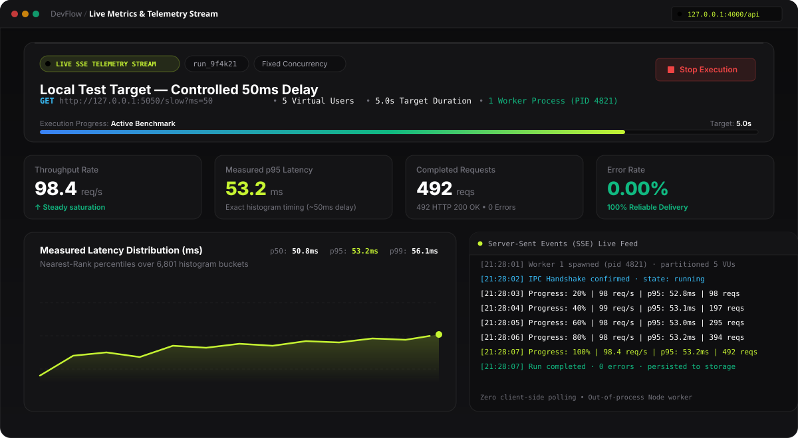

<div align="center">

  

  <br />
  <br />

  [](https://github.com/adityasinghr651/Devflow/actions)
  [](https://nodejs.org/)
  [](https://www.typescriptlang.org/)
  [](https://vitejs.dev/)
  [](https://www.postgresql.org/)
  [](LICENSE)

  <p align="center">
    <strong>An open-source HTTP performance regression gate &amp; load testing platform.</strong><br />
    Run repeatable API workloads, stream real-time sub-millisecond telemetry via Server-Sent Events, compare performance against historical baselines, and catch latency regressions before merging pull requests.
  </p>

  <p align="center">
    <a href="#quickstart-local-setup">Local Setup</a> •
    <a href="#using-devflow-via-hosted-web-app">Using via Hosted Link</a> •
    <a href="#how-to-test-the-platform">How to Test the Platform</a> •
    <a href="#ui-design--live-telemetry">UI &amp; Visual Tour</a> •
    <a href="#catch-performance-regressions-in-ci">CI Regression Checks</a> •
    <a href="#how-devflow-works">Architecture</a> •
    <a href="#rest-api-reference">REST API</a> •
    <a href="#configuration-reference">Configuration</a>
  </p>

</div>

---

> [!NOTE]
> **Project Scope:** DevFlow is an API load-testing platform and CI performance regression gate. Its load generator, saved run history, CLI (`devflow check`), and GitHub Action work together to compare a pull request's run with a baseline. Run checks only against systems you own or are explicitly authorized to test.

---

## Highlights & Engineering Principles

```text
  ┌─────────────────────────────────────────────────────────────────────────────┐
  │  ⚡ Bounded-Memory Histograms │ Exact O(1) memory across 6,801 buckets      │
  │  🔄 Zero-Polling Telemetry     │ Out-of-process Node workers push live SSE  │
  │  🛡️ Cryptographic Verification│ DNS TXT & HTTP challenge proofs block SSRF │
  │  🔀 Multi-Worker Isolation     │ Partitioned concurrency across CPU cores   │
  │  📈 CI Regression Checks        │ Compare API runs against matching history │
  │  💾 Dual Storage Engine        │ Zero-config JSON or PostgreSQL persistence │
  └─────────────────────────────────────────────────────────────────────────────┘
```

- **Sub-Millisecond Bounded Histograms:** Percentiles (p50, p90, p95, p99) are computed from exact nearest-rank buckets spanning 0.1 ms to 60,000 ms with fixed $O(1)$ memory guarantees—never by taking an inaccurate average of percentiles.
- **Real-Time Zero-Polling SSE Stream:** The backend runner coordinator broadcasts cumulative progress, throughput, and latency to browser connections via Server-Sent Events (SSE).
- **Process Isolation:** Dedicated Node.js worker child processes run the load generation loops, preventing benchmark traffic from starving the API server or distorting measurements.
- **Safety by Design:** Target endpoints require verification before testing remote hosts. Loopback addresses are restricted to local development environments.
- **Unified 1-Command Startup:** Launch the API, Vite React frontend, and local controlled test target together with `npm run dev:all`.

---

## Using DevFlow via Hosted Web App

If you are using DevFlow through a **deployed or hosted link** (e.g. `https://devflow.your-domain.com` or a cloud-hosted deployment), follow these steps to test endpoints directly from your browser:

### 1. Access & Sign-In
1. Navigate to the hosted DevFlow URL in your web browser.
2. Select your access mode:
   - **1-Click Instant Demo:** Click **Try Demo** on the landing page. This generates a temporary 24-hour session cookie with no registration required (limited to 10 runs, 2 Virtual Users, and up to 10 seconds duration).
   - **Registered Account:** Click **Sign In / Register** and create an account with an email and password (minimum 10 characters) for full concurrency and permanent run history.

### 2. Register Your API Target & Complete Domain Verification
To prevent Server-Side Request Forgery (SSRF) and protect third-party infrastructure, DevFlow requires domain ownership proof before running traffic against remote domains:

1. In the left navigation, click **API Targets** (`/targets`).
2. Click **+ Add API Target**.
3. Fill in the target details:
   - **Target Name:** An identifiable name (e.g., `Staging Checkout Service`).
   - **Base URL:** The HTTP/HTTPS root URL of your service (e.g., `https://api.staging.example.com`).
   - **Environment:** Select `Staging`, `Production`, or `Development`.
4. Click **Add Target**.
5. The target will display an **Unverified** status with a verification token (e.g. `st_tok_...`).
6. Click **Verify Target** and select one of the two proof methods:
   - **DNS TXT Record:** Add a TXT record to your DNS zone:
     ```text
     Host:  _devflow.api.staging.example.com
     Value: devflow-verification=st_tok_xxxxxxxxxxxx
     ```
   - **HTTP Challenge:** Place a static file accessible at:
     ```text
     https://api.staging.example.com/.well-known/devflow-challenge.txt
     ```
     containing the verification token as plain text.
7. Click **Confirm Verification**. Once verified, the target turns green and is unlocked for load testing.

### 3. Configure and Launch a Test Run
1. Go to **Test Runs** (`/runs`) or click **Run Test +** in the top navigation.
2. Configure your test scenario:
   - **Target:** Choose your verified API target.
   - **Path:** Specify the endpoint path (e.g., `/v1/products` or `/health`).
   - **HTTP Method:** `GET`, `POST`, `PUT`, `PATCH`, or `DELETE`.
   - **Concurrency (VUs):** Number of concurrent Virtual Users.
   - **Duration:** Test duration in seconds (e.g., `10s` or `30s`).
   - **Worker Count:** Number of partitioned worker processes (1, 2, or 4).
   - **Headers / Body:** (Optional) Add custom authorization headers or JSON payloads.
   - **Assertions:** (Optional) Define latency thresholds (e.g. `p95 < 150ms`) or expected status codes (`status == 200`).
3. Check the **"I confirm authorization to test this target"** checkbox.
4. Click **Launch Test**.

### 4. Monitor Live Telemetry in Real Time
1. The app automatically opens **Live Metrics** (`/live`).
2. Watch the live execution stream powered by Server-Sent Events (SSE):
   - **Execution Progress:** Active progress bar with real-time countdown.
   - **Throughput Gauge:** Live requests/second (RPS) saturation.
   - **Bounded Latency Histogram:** Dynamic p50, p90, p95, and p99 percentiles updated every second.
   - **Status Breakdown:** Real-time counts of HTTP 2xx, 4xx, and 5xx responses.
3. Click **Stop Execution** at any time to gracefully terminate child worker processes and finalize the run.

### 5. Analyze Results & Compare Against Baselines
1. Open **Test Runs** (`/runs`) or **History** to review finished executions.
2. Click any run to inspect its detailed summary:
   - 6,801-bucket latency distribution curve.
   - Exact percentiles, minimum/maximum/mean latency, and standard deviation.
   - Environment and worker process metadata.
3. **Compare Runs (`/comparisons`):** Select two completed runs against the same target to view a side-by-side delta showing whether throughput and latency degraded or improved.
4. **Export JSON Report:** Click **Export Report** to download the complete audit trail and metrics payload.

---

## Quickstart: Local Setup

Follow these steps to run DevFlow locally on your development machine.

### Prerequisites

- **Node.js**: `20.19+` or `22.12+` (LTS recommended)
- **npm**: `10+`
- **PostgreSQL** *(optional)*: Local JSON file storage is enabled by default with zero configuration.

### 1. Clone & Install

```bash
git clone https://github.com/adityasinghr651/Devflow.git
cd Devflow
npm ci
```

### 2. Configure Environment

Copy the default configuration:

```bash
# On Linux / macOS:
cp .env.example .env

# On Windows PowerShell:
Copy-Item .env.example .env
```

### 3. Launch All Services

Start the API, the React Web UI, and the controlled mock test target together with a single command:

```bash
npm run dev:all
```

| Service | Port | Endpoint | Description |
| :--- | :--- | :--- | :--- |
| **Web UI** | `3000` / `3001` | `http://localhost:3000` | React 19 + Vite modern dashboard |
| **Express API** | `4000` | `http://127.0.0.1:4000/api` | REST API &amp; SSE event broadcaster |
| **Controlled Test Target** | `5050` | `http://127.0.0.1:5050` | Mock server with predictable latency &amp; status endpoints |

*(Press `Ctrl+C` in your terminal to stop all running services).*

---

## How to Test the Platform

DevFlow provides several ways to test and verify the platform, from interactive UI tests to automated unit and validation suites.

### 1. End-to-End Test with the Mock Target (`tools/test-target.js`)

When running `npm run dev:all`, DevFlow starts a controlled loopback target on port `5050` with deterministic responses:

1. Open `http://localhost:3000` and click **Try Demo**.
2. Go to **API Targets** and confirm the `Local test target` (`http://127.0.0.1:5050`) is verified.
3. Click **Run Test** and select `http://127.0.0.1:5050`.
4. Test any of the following mock endpoints:

| Endpoint | Purpose | Expected Behavior |
| :--- | :--- | :--- |
| **`GET /slow?ms=50`** | Controlled Delay | Injects an exact 50ms delay. In **Live Metrics**, verify `p95` measures **`50–53 ms`**. |
| **`GET /health`** | Fast Baseline | Instant 200 OK response. Throughput saturates with sub-millisecond latency. |
| **`GET /status/500`** | Server Error | Returns HTTP 500. UI indicates **100% Error Rate** and highlights 5xx errors. |
| **`GET /mixed`** | Flaky Traffic | Alternates between 200 OK and 500 error. UI reports **50% Error Rate**. |
| **`GET /flaky?everyN=5`** | Deterministic Failure | Every 5th request returns 500. UI records an exact **20% Error Rate**. |
| **`GET /big?bytes=65536`** | Large Payloads | Returns a 64 KB octet-stream payload for payload handling and bandwidth testing. |
| **`GET /hang`** | Client Timeouts | Holds the connection open indefinitely until client `timeoutMs` triggers. |

### 2. Run the Measurement Validation Suite

Verifies latency measurement mathematics, worker isolation, and assertions across real child processes:

```bash
npm run test:validation
```

### 3. Run Unit and Integration Tests

```bash
# Run all unit tests (bounded histogram, auth, SSRF, migrations, CLI)
node --test tests/unit/*.test.js

# Run integration tests (E2E workflows, SSE streams, cancellation, storage)
node --test tests/integration/*.test.js

# Run full project test suite
npm test
```

---

## UI Design & Live Telemetry

DevFlow features a visual interface inspired by modern developer products, built on a high-contrast palette of **Midnight Black (`#0B0B0C`)**, **Pure White (`#FFFFFF`)**, and **Electric Lime (`#C6F432`)**.

### Interactive Playground & Simulator

The landing experience provides an interactive simulator equipped with live workload curve generation and real-time histogram previews:

<p align="center">
  
</p>

### Real Load Test in Action

The telemetry dashboard displays an active load test against `http://127.0.0.1:5050/slow?ms=50` with 5 Virtual Users, streaming real-time throughput and bounded latency percentiles:

<p align="center">
  
</p>

---

## Catch Performance Regressions in CI

DevFlow brings performance testing into pull request review: run the configured workload for a PR, compare its results with recent comparable runs, and detect performance regressions before deployment.

### How a CI Check Flows

```text
Pull request → GitHub Actions → `devflow check` → DevFlow API
                                      │                 ├─ runs configured HTTP workload
                                      │                 ├─ saves run results & compares history
                                      └─ PR summary ←───┴─ returns pass, regression, or insufficient data
```

### CLI One-Command Project Check

1. Link the CLI globally:
   ```bash
   npm link
   ```

2. Initialize a starter configuration in your repository:
   ```bash
   devflow check --init
   ```
   This generates `devflow.config.json`.

3. Set your `targetId` and export your authentication token:
   ```powershell
   # Windows PowerShell
   $env:DEVFLOW_TOKEN = "<your-token>"
   devflow check
   ```

   ```bash
   # Linux / macOS
   export DEVFLOW_TOKEN="<your-token>"
   devflow check
   ```

For GitHub Actions workflows, see [docs/CLI.md](docs/CLI.md), [examples/github-action-quickstart.yml](examples/github-action-quickstart.yml), and [docs/REGRESSION_DETECTION.md](docs/REGRESSION_DETECTION.md).

---

## 1M Request Benchmark Campaign

Benchmark Campaigns run four quota-based tests through DevFlow's worker coordinator: **250,000**, **500,000**, **750,000**, then **1,000,000** measured requests. Every stage receives a new run ID and fresh worker processes.

### Run an Opt-in Local Campaign

```powershell
$env:DEVFLOW_EMAIL = "your-account@example.com"
$env:DEVFLOW_PASSWORD = "your-password"
$env:DEVFLOW_CAMPAIGN_CONCURRENCY = "4,8,12,16"
$env:DEVFLOW_CAMPAIGN_WORKERS = "4"
npm run bench:campaign -- --confirm-large --path /health --method GET
```

Each stage completes, persists a full report under `benchmarks/results/`, and asks for approval before proceeding to the next stage.

---

## How DevFlow Works

```text
                                  DEVFLOW HOST (Single Machine)
  ┌─────────────────────────────────────────────────────────────────────────────────────────┐
  │                                                                                         │
  │   ┌───────────────┐     POST /api/runs       ┌───────────────┐       enqueue            │
  │   │  Browser UI   │ ───────────────────────> │  Express API  │ ─────────────────────┐   │
  │   │ (React 19)    │ <─────────────────────── │  (Port 4000)  │                      │   │
  │   └───────────────┘        SSE Stream        └───────────────┘                      │   │
  │           ▲                                          │ read / write                 │   │
  │           │                                          ▼                              ▼   │
  │           │                                  ┌───────────────┐              ┌───────────────┐
  │           │                                  │ Storage Layer │              │ Runner Mgr &  │
  │           │                                  │ Postgres/JSON │              │  Coordinator  │
  │           │                                  └───────────────┘              └───────────────┘
  │           │                                          ▲                              │
  │           │                                          │ persist                      │ fork + IPC
  │           │                                          │                              ▼
  │           │                                          │                      ┌───────────────┐
  │           │           IPC Progress & Latency Histograms                     │  Node Workers │
  │           └──────────────────────────────────────────────────────────────── │  (1, 2, or 4) │
  │                                                                             └───────────────┘
  │                                                                                     │
  └─────────────────────────────────────────────────────────────────────────────────────┼───┘
                                                                                        │ HTTP
                                                                                        ▼
                                                                                ┌───────────────┐
                                                                                │  HTTP Target  │
                                                                                │ (Local/Remote)│
                                                                                └───────────────┘
```

<p align="center">
  
</p>

### Execution Lifecycle

1. **Enqueuing:** The user configures a workload and authorizes execution. The API validates target permissions and inserts a `queued` run record.
2. **Workload Partitioning:** The runner manager boots an isolated coordinator. The coordinator divides virtual user concurrency evenly across $N$ child worker processes.
3. **Execution & Generation:** Each worker process executes HTTP requests against the target in a dedicated process loop, maintaining timing metrics using high-resolution timers (`process.hrtime.bigint()`).
4. **IPC Telemetry Aggregation:** Workers periodically transmit cumulative progress and 6,801-bucket histogram slices to the coordinator over IPC.
5. **SSE Broadcasting:** The coordinator merges the bounded histograms, writes progress updates to storage, and emits SSE events consumed by the browser in real time.
6. **Terminal Settlement:** Upon test completion (or graceful cancellation), final percentiles, throughput, and status code distributions are persisted.

---

## REST API Reference

All API routes are served under `/api` (`http://127.0.0.1:4000/api`).

### Health & System Status

```http
GET /api/health
```

**Response:**
```json
{
  "status": "ok",
  "version": "0.1.0",
  "storage": "json",
  "persistence": "file"
}
```

### Create and Queue a Load Test

```http
POST /api/runs
Authorization: Bearer <token>
Content-Type: application/json

{
  "targetId": "target_uuid",
  "path": "/slow?ms=50",
  "method": "GET",
  "concurrency": 5,
  "durationSec": 5,
  "workerCount": 1,
  "profile": "fixed",
  "timeoutMs": 5000,
  "authorized": true
}
```

### Live SSE Telemetry Stream

```http
GET /api/runs/:id/events?ticket=<stream-ticket>
Accept: text/event-stream
```

**Sample Stream Frame:**
```json
event: progress
data: {
  "runId": "run_9f4k21",
  "status": "running",
  "progressPercent": 60,
  "totalRequests": 295,
  "rps": 98.4,
  "p50": 50.8,
  "p95": 53.2,
  "p99": 56.1,
  "errorRate": 0.00
}
```

### Stop Execution

```http
POST /api/runs/:id/cancel
Authorization: Bearer <token>
```

---

## Configuration Reference

All environment variables can be configured via `.env`:

| Variable | Default | Purpose |
| :--- | :--- | :--- |
| `API_HOST` | `127.0.0.1` | Network interface for the API server |
| `API_PORT` | `4000` | Port bound by the Express API |
| `TARGET_PORT` | `5050` | Port for the controlled test target helper |
| `CORS_ORIGIN` | `http://localhost:3000` | Allowed browser origins (comma-separated for multi-port) |
| `VITE_API_URL` | `http://localhost:4000/api` | API endpoint used by the React web client |
| `ALLOW_LOCAL_TARGETS` | `true` | Allows testing loopback endpoints (`127.0.0.1`, `localhost`) |
| `JWT_SECRET` | *(development string)* | Secret for signing auth tokens (**change in production**) |
| `JWT_EXPIRES_IN` | `24h` | Validity duration of issued session tokens |
| `DATABASE_URL` | *(unset)* | PostgreSQL connection string. When unset, uses local JSON |
| `DATA_DIR` | `./data` | Directory for `store.json` when using JSON file storage |
| `MAX_ACTIVE_RUNS` | `1` | Maximum simultaneous test runs managed by this instance |
| `REQUEST_TIMEOUT_MS` | `5000` | Default per-request timeout for worker HTTP clients |
| `RUNNER_ENGINE` | `auto` | Engine selection: `auto`, `node`, or `k6` |

---

## Contributing

We welcome issues, feedback, and pull requests! To get started:

1. Fork the repository and create your feature branch: `git checkout -b feature/my-feature`.
2. Ensure all tests and type checks pass:
   ```bash
   npm run lint
   npm run build
   npm test
   ```
3. Commit your changes following conventional commit guidelines.
4. Submit a Pull Request. See [`CONTRIBUTING.md`](CONTRIBUTING.md) for full guidelines.

---

## License

This project is licensed under the [MIT License](LICENSE) — see the LICENSE file for details.
