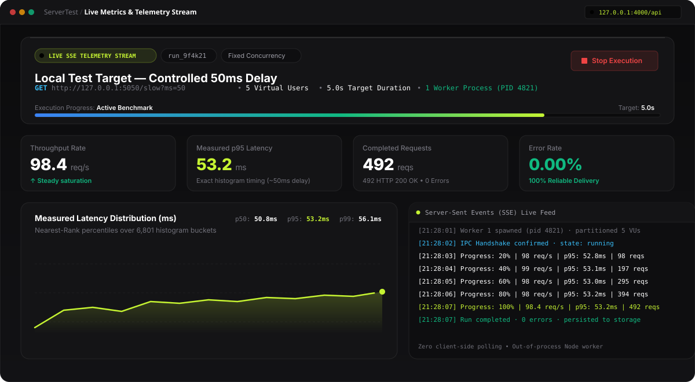

<div align="center">

  

  <br />
  <br />

  [](https://github.com/adityasinghr651/Devflow/actions)
  [](https://nodejs.org/)
  [](https://www.typescriptlang.org/)
  [](https://vitejs.dev/)
  [](https://www.postgresql.org/)
  [](CONTRIBUTING.md)

  <p align="center">
    <strong>A modern, self-hosted API load testing and resilience benchmarking platform.</strong><br />
    Exercise your APIs with multi-worker concurrency, stream live telemetry over SSE, and record exact sub-millisecond bounded histograms without event loop starvation.
  </p>

  <p align="center">
    <a href="#quickstart">Quickstart</a> •
    <a href="#ui-design--live-telemetry">UI &amp; Visual Tour</a> •
    <a href="#api-testing-walkthrough">API Testing Example</a> •
    <a href="#how-devflow-works">Architecture</a> •
    <a href="#rest-api-reference">REST API</a> •
    <a href="#configuration-reference">Configuration</a> •
    <a href="#contributing">Contributing</a>
  </p>

</div>

---

> [!NOTE]
> **Project Scope:** DevFlow runs locally on a single host using isolated child-process workers. It is engineered to give developers a predictable, private, and self-hosted load-testing suite. **Run tests only against systems you own or are explicitly authorized to test.**

---

## Highlights & Engineering Principles

```
  ┌─────────────────────────────────────────────────────────────────────────────┐
  │  ⚡ Bounded-Memory Histograms │ Exact O(1) memory across 6,801 buckets      │
  │  🔄 Zero-Polling Telemetry     │ Out-of-process Node workers push live SSE  │
  │  🛡️ Cryptographic Verification│ DNS TXT & HTTP challenge proofs block SSRF │
  │  🔀 Multi-Worker Isolation     │ Partitioned concurrency across CPU cores   │
  │  📈 Regression Gates           │ Median & MAD statistical bounds for CI/CD  │
  │  💾 Dual Storage Engine        │ Zero-config JSON or PostgreSQL persistence │
  └─────────────────────────────────────────────────────────────────────────────┘
```

- **Sub-Millisecond Bounded Histograms:** Percentiles (p50, p95, p99) are computed from exact nearest-rank buckets spanning 0.1 ms to 60,000 ms with fixed $O(1)$ memory guarantees—never by taking an inaccurate average of percentiles.
- **Real-Time Zero-Polling SSE Stream:** The backend runner coordinator broadcasts cumulative progress, throughput, and latency to open browser connections via Server-Sent Events (SSE).
- **Process Isolation:** Load generation child processes operate in dedicated Node.js event loops, preventing benchmark traffic from starving the API server or distorting measurements.
- **Safety by Design:** Target endpoints require verification before testing remote hosts. Loopback addresses are restricted to local development environments.
- **Unified 1-Command Startup:** Launch the API, Vite React frontend, and local controlled test target together with `npm run dev:all`.

---

## UI Design & Live Telemetry

DevFlow features a visual interface inspired by modern developer products, built on a high-contrast palette of **Midnight Black (`#0B0B0C`)**, **Pure White (`#FFFFFF`)**, and **Electric Lime (`#C6F432`)**.

### Interactive Playground & Simulator

The landing experience provides an interactive simulator equipped with live workload curve generation and real-time histogram previews:

<p align="center">
  
</p>

---

## API Testing Walkthrough

DevFlow includes a controlled loopback target helper (`tools/test-target.js`) that responds with deterministic latency for safe, predictable verification.

### Real Load Test in Action

The preview below illustrates an active load test against `http://127.0.0.1:5050/slow?ms=50` with 5 Virtual Users, streaming real-time throughput and bounded latency percentiles:

<p align="center">
  
</p>

### Step-by-Step Walkthrough

1. **Start all services** in one terminal:
   ```bash
   npm run dev:all
   ```
2. Open **<http://localhost:3000>** (or `3001` if port 3000 is occupied).
3. Sign in or register a local developer account.
4. Navigate to **API Targets** and confirm `Local test target` (`http://127.0.0.1:5050`) is verified.
5. Click **Run Test** and configure your workload:
   - **Target:** `Local test target`
   - **HTTP Method:** `GET`
   - **Path:** `/slow?ms=50`
   - **Concurrency:** `5 Virtual Users`
   - **Duration:** `5 seconds`
   - **Worker Count:** `1 worker`
6. Click **Launch Test** to start the execution.
7. Open **Live Metrics** to watch the real-time progress bar, throughput gauge, and live SSE event stream.
8. Review the final metrics: verify that `p95` latency measures approximately `50–53 ms`, reflecting the real endpoint delay.

---

## Quickstart

### Prerequisites

- **Node.js**: `20.19+` or `22.12+` (LTS recommended)
- **npm**: `10+`
- **PostgreSQL** *(optional)*: Only required if using database persistence. By default, DevFlow uses local JSON storage.

### 1. Clone & Install

```bash
git clone https://github.com/adityasinghr651/Devflow.git
cd Devflow
npm ci
```

### 2. Configure Environment

Copy the default configuration:

```bash
# On Linux / macOS:
cp .env.example .env

# On Windows PowerShell:
Copy-Item .env.example .env
```

### 3. Launch All Services

```bash
npm run dev:all
```

| Service | Port | Endpoint | Description |
| :--- | :--- | :--- | :--- |
| **Web UI** | `3000` / `3001` | `http://localhost:3000` | React 19 + Vite dashboard |
| **Express API** | `4000` | `http://127.0.0.1:4000/api` | REST API &amp; SSE event broadcaster |
| **Test Target** | `5050` | `http://127.0.0.1:5050` | Controlled mock target with delay endpoints |

*(Press `Ctrl+C` to stop all running processes).*

---

## How DevFlow Works

```
                                  DEVFLOW HOST (Single Machine)
  ┌─────────────────────────────────────────────────────────────────────────────────────────┐
  │                                                                                         │
  │   ┌───────────────┐     POST /api/runs       ┌───────────────┐       enqueue            │
  │   │  Browser UI   │ ───────────────────────> │  Express API  │ ─────────────────────┐   │
  │   │ (React 19)    │ <─────────────────────── │  (Port 4000)  │                      │   │
  │   └───────────────┘        SSE Stream        └───────────────┘                      │   │
  │           ▲                                          │ read / write                 │   │
  │           │                                          ▼                              ▼   │
  │           │                                  ┌───────────────┐              ┌───────────────┐
  │           │                                  │ Storage Layer │              │ Runner Mgr &  │
  │           │                                  │ Postgres/JSON │              │  Coordinator  │
  │           │                                  └───────────────┘              └───────────────┘
  │           │                                          ▲                              │
  │           │                                          │ persist                      │ fork + IPC
  │           │                                          │                              ▼
  │           │                                          │                      ┌───────────────┐
  │           │           IPC Progress & Latency Histograms                     │  Node Workers │
  │           └──────────────────────────────────────────────────────────────── │  (1, 2, or 4) │
  │                                                                             └───────────────┘
  │                                                                                     │
  └─────────────────────────────────────────────────────────────────────────────────────┼───┘
                                                                                        │ HTTP
                                                                                        ▼
                                                                                ┌───────────────┐
                                                                                │  HTTP Target  │
                                                                                │ (Local/Remote)│
                                                                                └───────────────┘
```

<p align="center">
  
</p>

### Execution Lifecycle

1. **Enqueuing:** The user configures a workload and authorizes execution. The API validates target permissions and inserts a `queued` run record.
2. **Workload Partitioning:** The runner manager boots an isolated coordinator. The coordinator divides virtual user concurrency evenly across $N$ child worker processes.
3. **Execution & Generation:** Each worker process executes HTTP requests against the target in a dedicated process loop, maintaining timing metrics using high-resolution timers (`process.hrtime.bigint()`).
4. **IPC Telemetry Aggregation:** Workers periodically transmit cumulative progress and 6,801-bucket histogram slices to the coordinator over IPC.
5. **SSE Broadcasting:** The coordinator merges the bounded histograms, writes progress updates to storage, and emits SSE events consumed by the browser in real time.
6. **Terminal Settlement:** Upon test completion (or graceful cancellation), final percentiles, throughput, and status code distributions are persisted.

---

## REST API Reference

All API routes are served under `/api` (`http://127.0.0.1:4000/api`).

### Health & System Status

```http
GET /api/health
```

**Response:**
```json
{
  "status": "ok",
  "version": "0.1.0",
  "storage": "postgresql",
  "persistence": "database"
}
```

### Create and Queue a Load Test

```http
POST /api/runs
Authorization: Bearer <token>
Content-Type: application/json

{
  "targetId": "target_default_local",
  "url": "http://127.0.0.1:5050/slow?ms=50",
  "method": "GET",
  "concurrency": 5,
  "durationSec": 5,
  "workerCount": 1,
  "profile": "fixed",
  "timeoutMs": 5000,
  "authorized": true
}
```

### Live SSE Telemetry Stream

```http
GET /api/runs/:id/events
Accept: text/event-stream
```

**Sample Stream Frame:**
```json
event: progress
data: {
  "runId": "run_9f4k21",
  "status": "running",
  "progressPercent": 60,
  "totalRequests": 295,
  "rps": 98.4,
  "p50": 50.8,
  "p95": 53.2,
  "p99": 56.1,
  "errorRate": 0.00
}
```

### Stop Execution

```http
POST /api/runs/:id/cancel
Authorization: Bearer <token>
```

---

## Testing & Quality Assurance

DevFlow features a comprehensive test suite powered by Node.js's native test runner (`node:test`).

```bash
# Run full unit and integration test suite
npm test

# Run TypeScript static type check (lint)
npm run lint

# Build production bundle with Vite
npm run build

# Focused bounded-memory latency histogram validation
node --test tests/unit/latency-histogram.test.js

# Real worker and telemetry integration test against loopback HTTP fixture
node --test tests/integration/real-run-telemetry.test.js

# Automated throughput benchmark against controlled target
npm run bench:ci
```

---

## Configuration Reference

All environment variables can be configured via `.env`:

| Variable | Default | Purpose |
| :--- | :--- | :--- |
| `API_HOST` | `127.0.0.1` | Network interface for the API server |
| `API_PORT` | `4000` | Port bound by the Express API |
| `TARGET_PORT` | `5050` | Port for the controlled test target helper |
| `CORS_ORIGIN` | `http://localhost:3000` | Allowed browser origins (comma-separated for multi-port) |
| `VITE_API_URL` | `http://localhost:4000/api` | API endpoint used by the React web client |
| `ALLOW_LOCAL_TARGETS` | `true` | Allows testing loopback endpoints (`127.0.0.1`, `localhost`) |
| `JWT_SECRET` | *(development string)* | Secret for signing auth tokens (**change in production**) |
| `JWT_EXPIRES_IN` | `24h` | Validity duration of issued session tokens |
| `DATABASE_URL` | *(unset)* | PostgreSQL connection string. When unset, uses local JSON |
| `DATA_DIR` | `./data` | Directory for `store.json` when using JSON file storage |
| `MAX_ACTIVE_RUNS` | `1` | Maximum simultaneous test runs managed by this instance |
| `REQUEST_TIMEOUT_MS` | `5000` | Default per-request timeout for worker HTTP clients |
| `RUNNER_ENGINE` | `auto` | Engine selection: `auto`, `node`, or `k6` |

---

## Contributing

We welcome issues, feedback, and pull requests! To get started:

1. Fork the repository and create your feature branch: `git checkout -b feature/my-feature`.
2. Ensure all tests and type checks pass:
   ```bash
   npm run lint
   npm run build
   npm test
   ```
3. Commit your changes following conventional commit guidelines.
4. Submit a Pull Request. See [`CONTRIBUTING.md`](CONTRIBUTING.md) for full guidelines.

---

## License

This project is licensed under the [MIT License](LICENSE) — see the LICENSE file for details.
