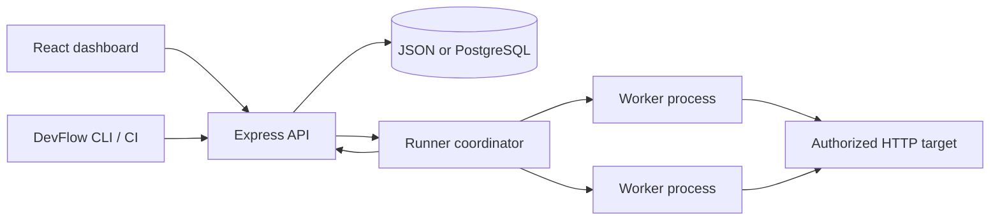

# Architecture

The API authenticates and validates requests, applies per-user quotas and target safety checks, persists run state, and dispatches work to local child processes. Worker snapshots update the stored run and SSE stream. The worker processes are on the same machine as the API; this is not a distributed fleet or a cloud load generator. See [metrics semantics](METRICS.md) and [operations](OPERATIONS.md).
